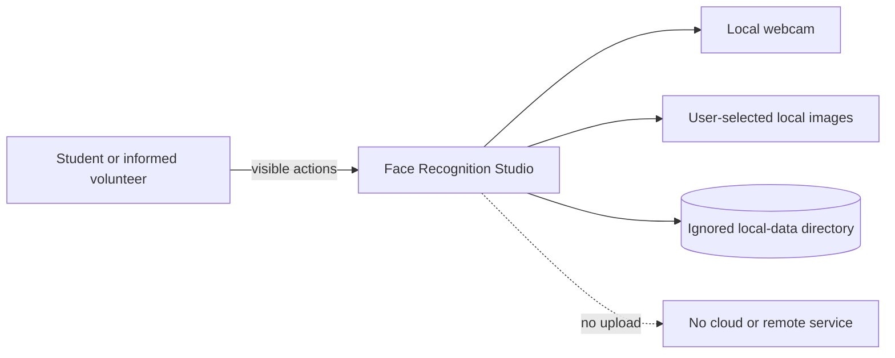
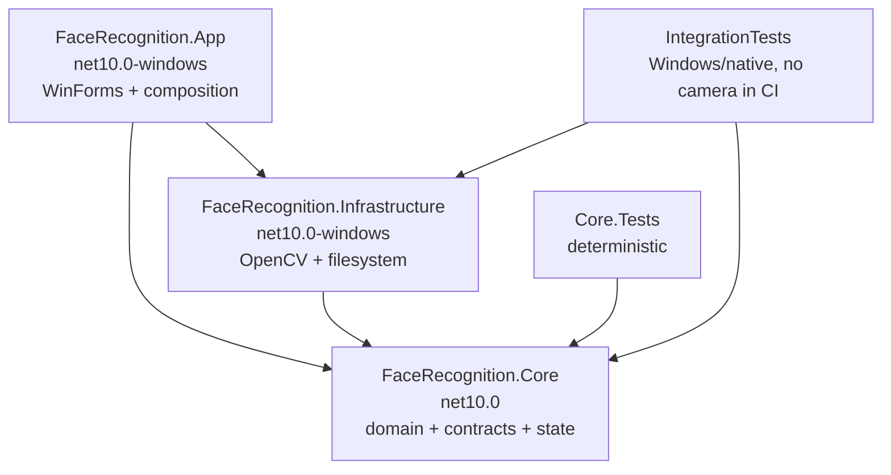
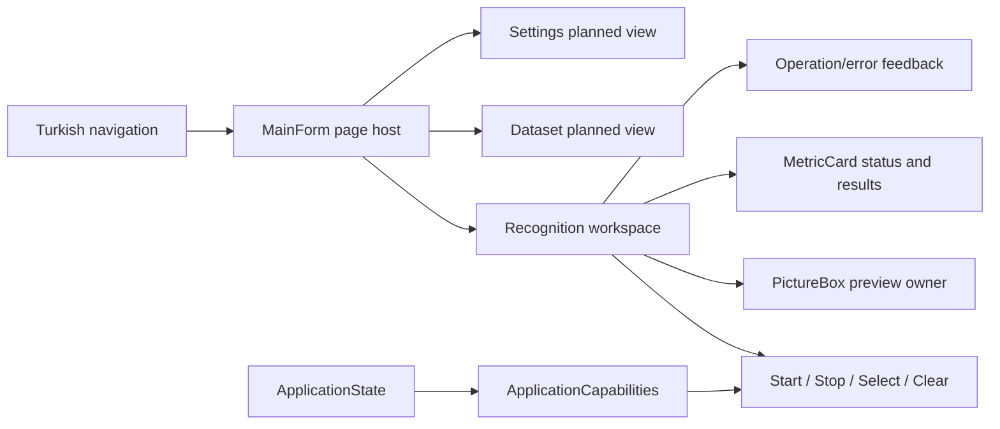
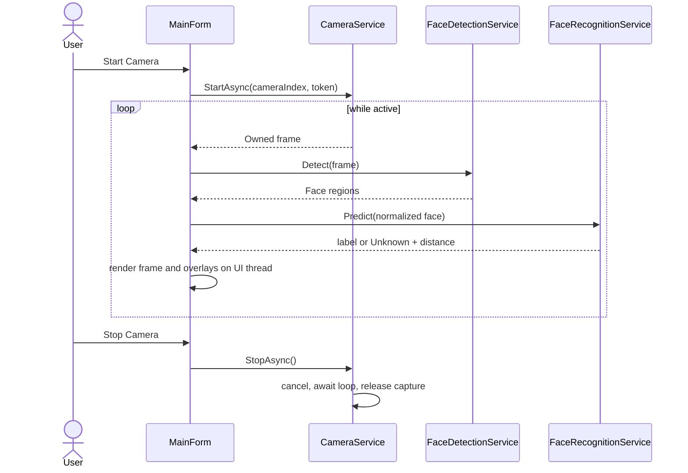
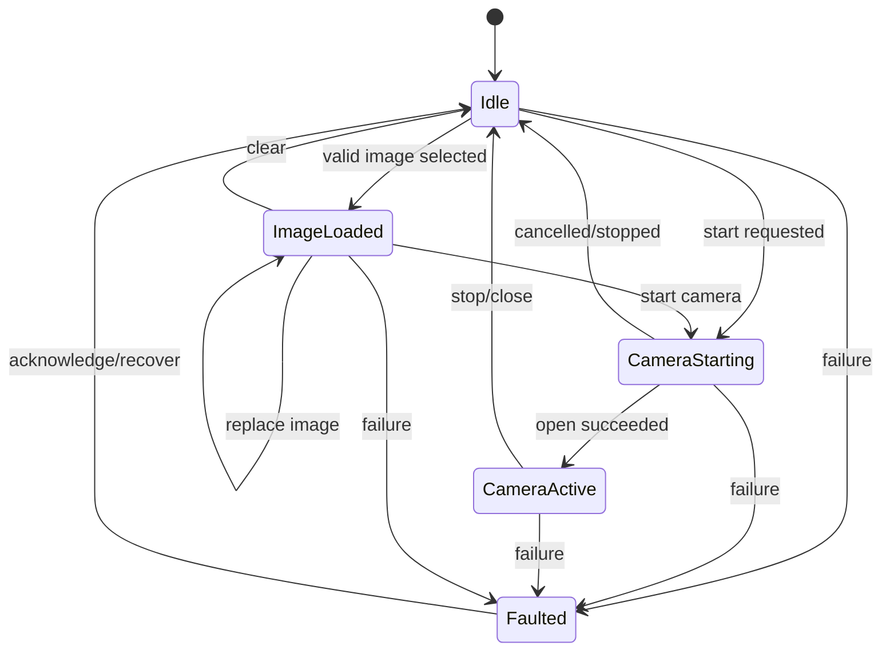
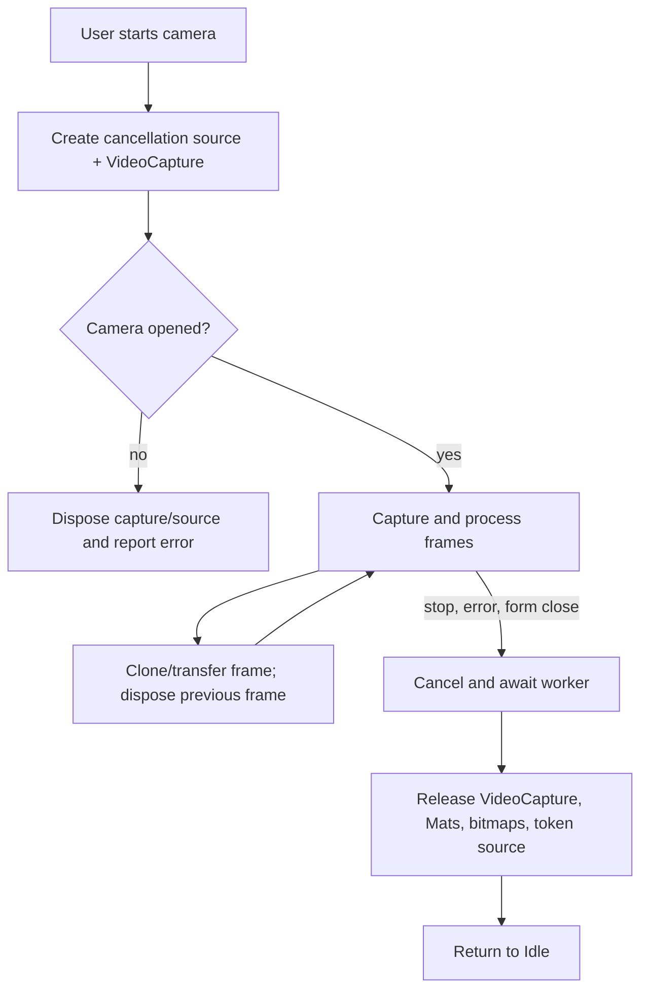

# Architecture

## 1. System context

The application is a single-user desktop process. The camera and user-selected
files are external inputs; voluntary samples and the trained model remain local.

## 2. Layers and dependencies

Core cannot expose `Mat`, `Bitmap`, WinForms controls, native handles, paths, or
other infrastructure concerns. Infrastructure converts between OpenCV objects
and Core-owned results. App converts presentation images and updates controls.

## 3. Responsibilities

| Component | Responsibility | Status |
|---|---|---|
| MainForm | Responsive recognition view, navigation, commands, status, preview ownership | Interface implemented; sources planned |
| MetricCard | Repeated accessible result/status presentation | Implemented |
| TrainingForm | Explicit sample management, training, deletion | Planned |
| Dataset/Settings views | Truthful in-form planned-feature information | Implemented as placeholders |
| ApplicationState | Valid high-level operation transitions | Implemented |
| ApplicationCapabilities | UI-independent valid-command mapping | Implemented and tested |
| CameraService | Open/read/stop camera and own VideoCapture | Planned |
| ImageService | Validate/decode user-selected images | Planned |
| FaceDetectionService | Load cascade and return all face regions | Planned |
| FaceRecognitionService | Normalize face ROIs and return LBPH predictions | Planned |
| DatasetService | Validate labels/samples and local paths | Planned |
| TrainingService | Train LBPH from valid samples | Planned |
| ModelStorageService | Atomically save/load/delete model and metadata | Planned |

Interfaces will be introduced when their first implementation or test double is
needed; PR #01 continues to avoid speculative service contracts.

### Implemented presentation structure

The form uses WinForms layout containers and font-based autoscaling. It owns and
disposes any PictureBox image when replaced, cleared, or closed. PR #01 does not
create capture workers, timers, native frames, or file dialogs.

## 4. Planned recognition sequence

## 5. State transitions

`ApplicationState` implements these transitions without UI or hardware.
`ApplicationCapabilities` now maps each mode to Start, Stop, Select, and Clear
availability; MainForm applies that mapping to controls.

## 6. Native resource lifecycle

Ownership must be explicit. A service never returns an OpenCV object through a
Core contract. When App replaces a PictureBox image, it disposes the previous
bitmap after detaching it.

## 7. Error handling

- Expected failures become typed results or documented exceptions at the
  infrastructure boundary.
- App shows concise actions such as “Camera 0 is unavailable or already in use.”
- Diagnostic exceptions are retained for logs/debugging without exposing sample
  names or paths unnecessarily.
- Partially created native resources are disposed in `finally`/`using` paths.
- Invalid or missing models yield “model unavailable”; they do not silently
  label a face.

## 8. Storage boundary

`assets/models/` is for reviewed, distributable detector assets only.
`local-data/` is ignored and will hold samples, label metadata, and trained
models. Future writes should use a temporary file plus atomic replacement where
supported. Deletion must cover both metadata and biometric files.

## 9. Design approach

The architecture applies dependency inversion at the native boundary, immutable
result/state models, explicit state transitions, and deterministic disposal.
There is no database, mediator, event bus, generic repository, or elaborate DI
container because the application does not need them.
