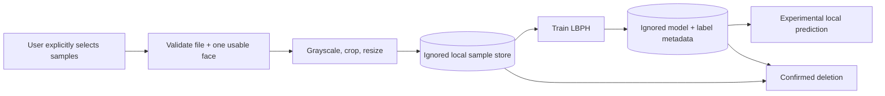

# Computer Vision Design

## Detection and recognition are different

**Face detection** answers “where are face-like regions?” and returns
rectangles. **Face recognition** compares a normalized detected region with a
small trained local set and returns a label candidate. A detector does not know
identity, and recognition must not run on an arbitrary full frame.

Both are planned. PR #00 only proves that the full OpenCV native runtime and
LBPH module can load; it does not perform either operation.

## Planned detection: Haar cascade

OpenCV's frontal-face Haar cascade applies a sequence of learned rectangular
intensity features at different image scales. It is lightweight, explainable,
offline, and sufficient for a course demonstration. It is less robust than
modern neural detectors for rotated faces, occlusion, strong pose, or difficult
lighting.

The planned pipeline is:

1. Decode a BGR frame or image.
2. Convert to grayscale.
3. Optionally equalize illumination after validation.
4. call `CascadeClassifier.DetectMultiScale` with documented parameters.
5. clamp returned regions to image bounds.
6. draw every valid rectangle on a presentation copy.

No cascade XML is committed in PR #00. A later PR must obtain
`haarcascade_frontalface_default.xml` from the official OpenCV repository, pin an
OpenCV release or commit, review its license, record its URL, and record a
SHA-256 checksum before committing it.

## Planned recognition: LBPH

Local Binary Patterns Histograms describes each grayscale face through local
texture comparisons, divides the image into a grid, and compares histograms.
OpenCV's `LBPHFaceRecognizer` supports small local datasets and incremental
educational demonstrations without a GPU or cloud service.

Training samples must be detected, cropped, converted to grayscale, and resized
to the same dimensions. A label-ID map will be stored separately as local JSON.
Prediction returns an integer model label and a numeric distance. Lower distance
generally means closer under this model; the value is **not** a probability,
accuracy percentage, or verified identity.

An “Unknown” decision requires a threshold chosen and documented through local
evaluation. PR #00 does not choose a threshold because no representative,
consented dataset has been evaluated. The application must not always display
the nearest label.

## Dataset and model lifecycle

At least two voluntary labels are required for the professor demonstration.
Samples should vary modestly in expression and lighting while remaining clear.
Only the student's own samples or informed volunteers may be used.

## Evaluation plan

Evaluation will be recorded in PR #04/#05 and will separate training samples
from evaluation samples. It will cover:

- known-label predictions under ordinary lighting;
- unknown rejection using a consented non-enrolled sample or permitted
  alternative samples;
- multiple detected faces;
- no-face and multiple-face enrollment rejection;
- pose, illumination, and camera-quality sensitivity;
- observed distances without converting them to percentages.

No accuracy, false-match rate, timing, or threshold result exists yet.

## Limitations

- Haar detection may miss profiles, small faces, or occluded faces and may
  produce false positives.
- LBPH can overfit small datasets and is sensitive to alignment, pose, lighting,
  resolution, and dataset imbalance.
- There is no liveness detection; a photograph could be presented to a camera.
- A prediction does not establish legal or real-world identity.
- The educational dataset is too small for demographic or production claims.

## Difference from the Python attendance reference

The reference used Python, Streamlit, `face_recognition`/dlib embeddings, and a
database-backed attendance workflow. This independent project uses C#,
WinForms, OpenCvSharp, Haar detection, and planned LBPH. It intentionally omits
employees, attendance rules, persistence databases, reports, and exports. Only
the reference project's separation, validation, unknown-result handling,
local-first privacy, testing, and cleanup lessons are retained.
